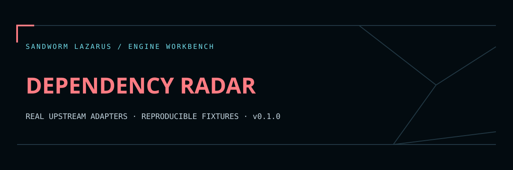

# Sandworm Dependency Radar



Review OSV-Scanner findings across runs, with published fixed-version evidence and exact-input SHA-256. Built by Sandworm-Lazarus; OSV-Scanner remains Google's upstream engine. Original adapter/triage logic is MIT; OSV-Scanner is Apache-2.0.

เครื่องมืออ่านผลช่องโหว่ dependency ของเรา: สรุปแพ็กเกจ/รายการแจ้งเตือน/รุ่นที่ upstream ระบุว่าแก้แล้ว และเทียบรายการใหม่–หายไปกับ baseline เก็บหลักฐาน hash ของ JSON ที่ใช้จริง ผลศูนย์รายการไม่ได้รับรองว่าปลอดภัย และรายการหายไปไม่ได้พิสูจน์ว่าแพตช์สำเร็จ

## Quick start — no engine required

Python 3.11+ on Linux. Runtime has no Python third-party dependencies.

```sh
python -m sandworm_radar import-report examples/osv-report.json --out report.json
python -m sandworm_radar import-report examples/osv-report.json --baseline report.json --out compared.json
python scripts/validate.py
```

Open the Sandworm-themed report viewer at `web/index.html`, load its synthetic example or import `report.json`. Serve the directory locally when a browser restricts file assets: `python -m http.server 8080 --directory web`. The viewer only reads reports; scanning runs in the CLI worker. JSON fixtures use invented packages/advisories.

## Real OSV-Scanner integration

`upstream-lock.json` pins OSV-Scanner **2.7.1** and the SHA-256 of its official Linux/amd64 release asset. Installation is explicit; importing this package never downloads or runs an engine.

```sh
python scripts/install_upstream.py
mkdir -p .runtime/osv-db
OSV_SCANNER_LOCAL_DB_CACHE_DIRECTORY="$PWD/.runtime/osv-db" .tools/osv-scanner scan source --offline --download-offline-databases ./YOUR_PROJECT
python -m sandworm_radar scan ./YOUR_PROJECT --binary "$PWD/.tools/osv-scanner" --db-cache .runtime/osv-db --out report.json
```

The database-preparation command downloads OSV ecosystem databases. The Sandworm `scan` adapter always uses full `--offline`, `--no-resolve`, and disables Go/Rust call analysis/build scripts. It passes a minimal environment without inherited cloud credentials. A missing/incompatible database produces an error, never an empty completed report. OSV's database location contract is documented at <https://google.github.io/osv-scanner/usage/offline-mode/>.

ไฟล์ source จะถูกเลือกจากโฟลเดอร์ในเครื่องเท่านั้น ไม่รับ URL หรือสั่งติดตั้ง dependency รายงานมีชื่อแพ็กเกจ รุ่น และ relative path จึงต้องตรวจทานก่อนแชร์ ข้อมูลฐานช่องโหว่ต้องเตรียมแยกก่อนสแกน offline

## Baseline comparison

```sh
python -m sandworm_radar diff before.json after.json --out diff.json
```

Identity is a SHA-256 of ecosystem/name/version/advisory ID. Repeated identical findings in multiple lockfiles merge their source list; conflicting duplicates fail. Every input is bounded UTF-8 JSON and duplicate object keys are rejected. Raw package source, advisory descriptions and scanner stderr are not copied into reports. Absolute/parent-traversing source paths are replaced with a marker.

Fixed versions are matching OSV `affected.ranges[].events[].fixed` entries. They are evidence that a fix was published, not a claim that a particular upgrade is compatible, reachable, or sufficient. Severity is the upstream group numeric score when present; unknown remains null. Database publication timestamp is null when the source report does not establish it.

## Validation

`python scripts/validate.py` writes `reports/validation.json`, binding regression results to source/fixture/viewer SHA-256. `python scripts/smoke.py` runs the actual pinned OSV binary against the synthetic project and a generated, explicitly synthetic offline vulnerability database; it needs no project upload or vulnerability service call. See `reports/live-smoke.json` for the observed engine run, not a claim about any real application.

## Cloud worker deployment

Use a disposable Linux worker/container with the repo mounted read-only, a preloaded offline OSV DB and a dedicated output directory. Schedule the CLI in your own worker/CI. This repo creates no always-on worker, hosted service, GitHub token or billing configuration. See [SECURITY.md](SECURITY.md), [development notes](docs/DEVELOPMENT.md), and [upstream notices](THIRD_PARTY_NOTICES.md).

Outputs must use a new file name. Creation is atomic and exclusive: existing reports, scanned files and symlinks are never overwritten. JSON file inputs must be regular files; FIFOs, devices and symlinks are rejected before reading.

## Sandworm report workspace

The original Sandworm navy/coral theme is included in `web/`. Read [the viewer guide](docs/WEB_VIEWER.md) for local serving, normalized JSON import and export, and [verification scope](docs/BROWSER_QA.md) for the browser QA limit. Run `node --test tests/web.test.cjs` alongside the engine checks above. No worker or scheduler is deployed by opening this static viewer.

The cloud development and upstream smoke checks are reproducible from this repository. A continuously running service needs your own worker/server, authentication, job limits and operational setup. Public source contains synthetic fixtures; local dependencies, secrets, scan targets, model caches and databases are excluded.

Original Sandworm code is MIT-licensed. Upstream engines retain their respective licenses and credit; embedded fonts use OFL with notices in `web/fonts/`.
